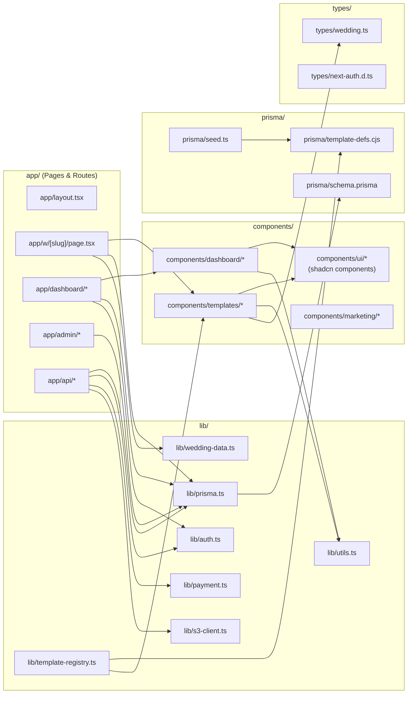
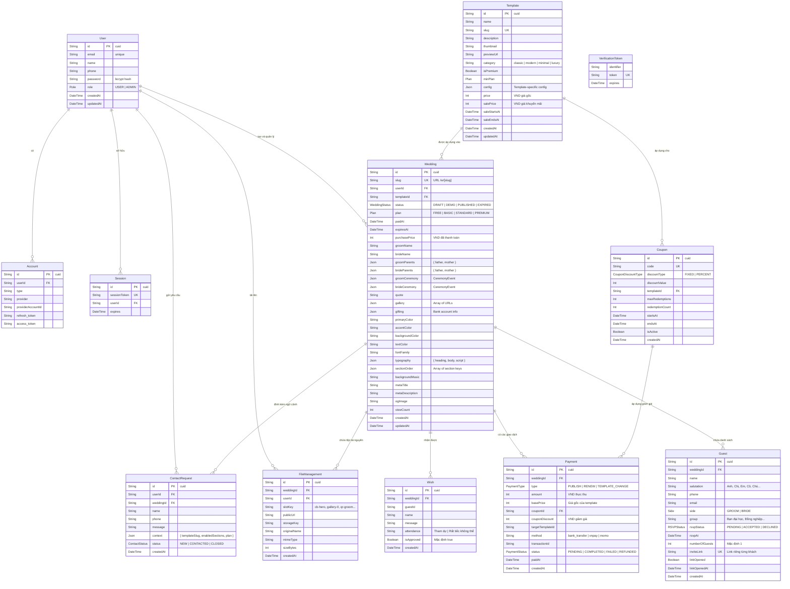
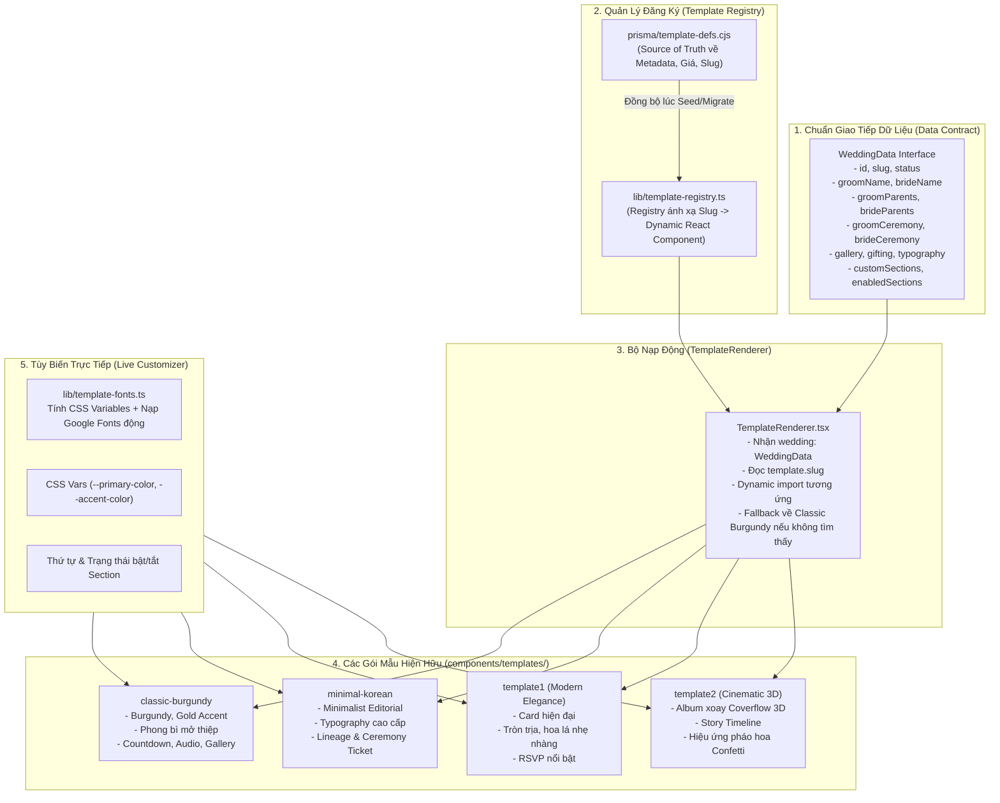
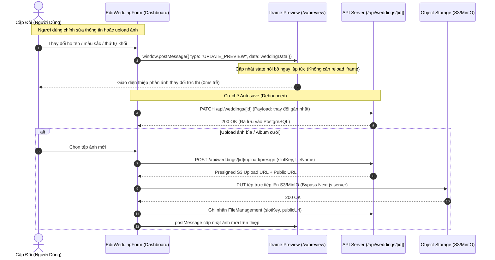
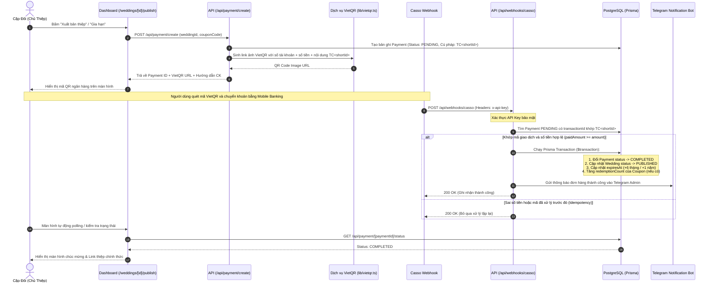
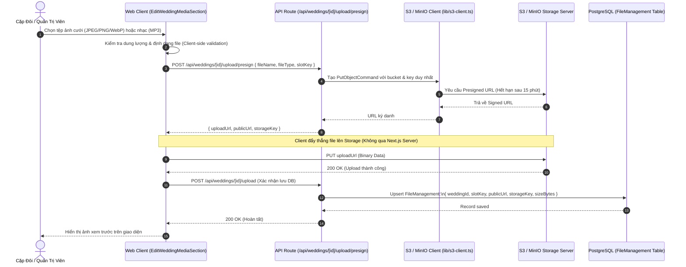

# Code Graph & Kiến Trúc Hệ Thống (Architecture & Code Graph)

Tài liệu này cung cấp sơ đồ trực quan hóa toàn diện kiến trúc mã nguồn (Code Graph), quan hệ thực thể dữ liệu (ERD), cơ chế Template Engine và các luồng dữ liệu cốt lõi (Data Flow) của hệ thống **Online Wedding Invitations (Thiệp Cưới Online)**.

---

## 1. Sơ Đồ Phân Tầng Kiến Trúc Tổng Thể (System Architecture Graph)

Hệ thống được thiết kế theo mô hình **Phân tầng hướng mô-đun (Modular Layered Architecture)** trên nền tảng Next.js 14 App Router, kết hợp Server Components và Client Components:

```mermaid
flowchart TB
    %% Client Layer
    subgraph ClientLayer ["1. Tầng Khách Hàng & Trình Duyệt (Client Layer)"]
        GuestUser["Khách Mời (Guest)\n/w/[slug]?guest=..."]
        CoupleUser["Cặp Đôi (Couple)\n/dashboard, /dashboard/weddings/[id]/edit"]
        AdminUser["Quản Trị Viên (Admin)\n/admin, /admin/templates, /admin/coupons"]
        PublicUser["Khách Vãng Lai (Visitor)\n/, /templates, /pricing"]
    end

    %% Security & Edge Layer
    subgraph EdgeLayer ["2. Tầng Bảo Mật & Routing (Edge & Middleware)"]
        MW["middleware.ts\n- Session Check (NextAuth)\n- RBAC (Role: ADMIN / USER)\n- Public Route Pass-through"]
    end

    %% Presentation Layer
    subgraph PresentationLayer ["3. Tầng Giao Diện & Điều Hướng (Next.js App Router)"]
        direction TB
        subgraph RouteGroups ["Route Groups (app/)"]
            AuthRoutes["app/(auth)\n/login, /register"]
            MarketingRoutes["app/(marketing)\n/, /pricing, /templates"]
            DashboardRoutes["app/dashboard\nOverview, Editor, Guests, RSVP, Analytics"]
            AdminRoutes["app/admin\nPayments, Templates, Coupons, Contacts"]
            PublicWedding["app/w/[slug]\nPublic Wedding Page (SSR + Dynamic Metadata)"]
            PreviewIframe["app/w/preview\nLive Preview Sandbox (postMessage listener)"]
        end
        subgraph CoreComponents ["Thành Phần Giao Diện (components/)"]
            UIComp["components/ui/\nRadix UI, Tailwind, Lucide Icons"]
            DashComp["components/dashboard/\nEditWeddingForm, Live Preview, Media Upload"]
            MktComp["components/marketing/\nHero, Features, PricingCards, TemplateShowcase"]
        end
    end

    %% Template Engine Layer
    subgraph TemplateEngine ["4. Hệ Thống Template Engine Độc Lập"]
        Renderer["TemplateRenderer.tsx\n(Dynamic Component Loader)"]
        Registry["lib/template-registry.ts\n(Template Registry Singleton)"]
        T_Burgundy["classic-burgundy\n(Cổ Điển Burgundy)"]
        T_Korean["minimal-korean\n(Hàn Quốc Tối Giản)"]
        T_Modern["template1\n(Hiện Đại Sắc Nét)"]
        T_Cinematic["template2\n(Cinematic 3D Album)"]
    end

    %% Business & Service Layer
    subgraph BusinessLayer ["5. Tầng Nghiệp Vụ & Dịch Vụ (lib/)"]
        AuthService["lib/auth.ts\nNextAuth Handler & Callbacks"]
        PaymentService["lib/payment.ts & payment-complete.ts\nCú pháp TC<shortId>, Idempotency"]
        VietQRService["lib/vietqr.ts\nSinh VietQR chuẩn Napas 247"]
        UploadService["lib/upload-client.ts & s3-client.ts\nPresigned S3 / Local Storage"]
        WeddingDataService["lib/wedding-data.ts\nDTO Serializer, Normalizer"]
        FontService["lib/template-fonts.ts\nDynamic Google Fonts Loader"]
    end

    %% API Route Handlers
    subgraph APILayer ["6. Tầng API Endpoints (app/api/)"]
        AuthAPI["/api/auth/*\nNextAuth, Register"]
        WeddingAPI["/api/weddings/*\nCRUD, Publish, Upload Presign, Export"]
        GuestAPI["/api/guests/* & /api/rsvp/*\nQuản lý khách mời, Xác nhận RSVP"]
        WishAPI["/api/wishes/*\nGửi & Duyệt lời chúc"]
        PaymentAPI["/api/payment/* & /api/webhooks/casso\nTạo đơn & Casso Banking Webhook"]
        AdminAPI["/api/admin/*\nQuản trị template, Sync, Coupon"]
    end

    %% Persistence & Storage Layer
    subgraph DataLayer ["7. Tầng Dữ Liệu & Hạ Tầng (Storage & External Services)"]
        PrismaClient["lib/prisma.ts\nPrisma ORM Client Singleton"]
        PostgreSQL[("PostgreSQL Database\n(ACID Relational Storage)")]
        S3Storage[("S3 / MinIO Object Storage\n(Ảnh cưới, Nhạc nền, QR)")]
        CassoService["Casso API\n(Biến động số dư ngân hàng)"]
        TelegramService["Telegram Bot API\n(Thông báo giao dịch tức thì)"]
    end

    %% Connectors
    GuestUser --> MW
    CoupleUser --> MW
    AdminUser --> MW
    PublicUser --> MW

    MW --> RouteGroups
    DashboardRoutes --> DashComp
    PublicWedding --> Renderer
    PreviewIframe --> Renderer
    Renderer --> Registry
    Registry --> T_Burgundy & T_Korean & T_Modern & T_Cinematic

    DashComp -.->|"Gửi state tức thì qua postMessage"| PreviewIframe
    DashComp --> WeddingAPI
    DashComp --> UploadService

    RouteGroups --> BusinessLayer
    APILayer --> BusinessLayer
    BusinessLayer --> PrismaClient
    PrismaClient --> PostgreSQL

    UploadService --> S3Storage
    PaymentService --> VietQRService
    PaymentAPI --> PaymentService
    CassoService -->|Webhook POST| PaymentAPI
    PaymentService --> TelegramService
```



---

## 2. Sơ Đồ Phụ Thuộc Thư Mục & Module (Directory & Module Graph)

Sơ đồ thể hiện liên kết import giữa các thư mục chính trong dự án:



---

## 3. Sơ Đồ Thực Thể Cơ Sở Dữ Liệu (Database ERD Code Graph)

Toàn bộ 12 Model của Prisma Schema và mối quan hệ giữa chúng:



---

## 4. Sơ Đồ Kiến Trúc Template Engine (Template Engine & Registry)

Cơ chế phân tách template độc lập giúp mở rộng thêm mẫu mới mà không ảnh hưởng đến hệ thống lõi:



---

## 5. Sơ Đồ Luồng Biên Tập Trực Quan Thời Gian Thực (Live Customizer Flow)

Luồng tương tác giữa Trình biên tập cha (`EditWeddingForm`) và Khung xem trước iframe (`/w/preview`):



---

## 6. Sơ Đồ Luồng Thanh Toán Tự Động VietQR & Casso (Automated Payment Flow)

Luồng thanh toán không cần can thiệp thủ công, sử dụng chuẩn VietQR và webhook Casso:



---

## 7. Sơ Đồ Luồng Khách Mời & Tương Tác RSVP (Guest Experience Flow)

Luồng khách mời nhận thiệp mời cá nhân hóa, xem thiệp và xác nhận tham dự:

```mermaid
flowchart TD
    StartGuest([Khách mời mở link:\n/w/thanhtung-huonggiang?guest=Anh+Hoang&side=groom]) --> SSRFetch[Next.js Server SSR:\nFetch Wedding + Guest info]

    SSRFetch --> GenMeta[generateMetadata:\nSinh Title, Description, Open Graph Image chuẩn SEO]
    GenMeta --> TrackOpen{Có query guestId?}

    TrackOpen -->|Có| MarkLinkOpened[Ghi nhận linkOpened: true\nCập nhật linkOpenedAt vào DB]
    TrackOpen -->|Không| RenderPage[Tải giao diện Thiệp Cưới]
    MarkLinkOpened --> RenderPage

    RenderPage --> EnvelopeScene[1. Hoạt Cảnh Mở Phong Bì\nHiệu ứng sáp niêm phong & lời chào cá nhân]
    EnvelopeScene --> PlayMusic[2. Phát Nhạc Nền\n(Tự động hoặc tương tác bật âm thanh)]
    PlayMusic --> HeroCountdown[3. Thông Tin Cặp Đôi & Countdown Đếm Ngược]
    HeroCountdown --> GalleryCoverflow[4. Album Ảnh Cưới 3D & Chuyện Tình Yêu]
    HeroCountdown --> FamilyInfo[5. Lễ Cưới Nhà Trai / Nhà Gái & Bản Đồ Google Maps]

    FamilyInfo --> RSVPAction{Khách mời tương tác}

    RSVPAction -->|Xác nhận tham dự| SubmitRSVP[Gửi Form RSVP:\n- Họ tên, SĐT, Số người đi cùng\n- Trạng thái: ACCEPTED / DECLINED]
    SubmitRSVP --> PostRSVP[POST /api/rsvp]
    PostRSVP --> UpdateGuestDB[(Cập nhật Guest.rsvpStatus)]

    RSVPAction -->|Gửi lời chúc| SubmitWish[Nhập lời chúc phúc cho cặp đôi]
    SubmitWish --> PostWish[POST /api/wishes]
    PostWish --> SaveWishDB[(Lưu Wish vào DB)]

    RSVPAction -->|Mừng cưới| OpenQR[Xem mã QR mừng cưới Nhà Trai / Nhà Gái]
    OpenQR --> BankApp[Mở App Ngân Hàng chuyển khoản trực tiếp]
```

---

## 8. Sơ Đồ Luồng Upload Tài Nguyên Đa Phương Tiện (Asset Storage Flow)

Quy trình tải ảnh cưới và nhạc nền với kiến trúc Presigned URL an toàn:



---

## 9. Hướng Dẫn Mở Rộng Dành Cho Lập Trình Viên (Developer Guide)

### Thêm Mẫu Thiệp Mới (New Template)
Khi phát triển template mới, cần tuân thủ đúng 3 bước theo quy chuẩn hệ thống:
1. **Định nghĩa Metadata**: Khai báo tại `prisma/template-defs.cjs` (gồm slug, tên, giá, các section hỗ trợ).
2. **Xây dựng Component**: Tạo thư mục tại `components/templates/[slug]/`, tuân thủ nhận prop chuẩn `WeddingData`.
3. **Đăng ký vào Registry**: Khai báo dynamic import tại `lib/template-registry.ts`.
4. **Chạy kiểm thử & build**: `npm test` và `npm run build` để đảm bảo tương thích type-safety 100%.
