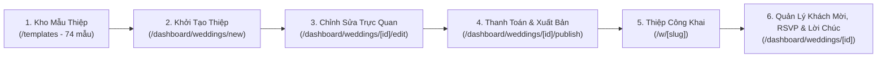

# KẾ HOẠCH BÀN GIAO & VẬN HÀNH HỆ THỐNG THIỆP CƯỚI ONLINE (WINGLOVE)

Tài liệu này chuẩn hóa toàn bộ luồng nghiệp vụ, kiến trúc kỹ thuật, quy trình xuất bản (Publish), vận hành thanh toán và danh mục nghiệm thu bàn giao cho khách hàng.

---

## 1. Tổng Quan Luồng Nghiệp Vụ Đã Chuẩn Hóa (End-to-End Workflow)

Hệ thống đã được chuẩn hóa xuyên suốt 6 bước khép kín từ lúc khách hàng truy cập đến khi gửi thiệp cho khách mời:



### Chi tiết từng bước:
1. **Kho Mẫu Thiệp (`/templates` & `/templates/[slug]`)**:
   - Tổng cộng **74 mẫu thiệp** (72 mẫu từ `thieponline.app` + 2 mẫu truyền thống gốc `Hồng Sắc Hỷ` & `Trầu Cau Đỏ`).
   - Hỗ trợ tìm kiếm, lọc theo chủ đề (`Hiện đại`, `Sang trọng`, `Lãng mạn`, `Truyền thống`), lọc theo `Hot` và `Tags`, phân trang mượt mà.
   - Xem trước từng mẫu ở chế độ Mobile / Desktop và chế độ Nhà Trai / Nhà Gái.
2. **Khởi Tạo Thiệp Mới (`/dashboard/weddings/new`)**:
   - **Bước 1 (Chọn mẫu)**: Tự động nhận mẫu khi bấm *"Dùng mẫu này"* từ trang kho mẫu hoặc chọn trực tiếp.
   - **Bước 2 (Thông tin cơ bản)**: Nhập tên Chú Rể, Cô Dâu, ngày giờ lễ cưới Nhà Trai / Nhà Gái, địa điểm.
   - **Bước 3 (Xem trước thực tế)**: Hiển thị trực tiếp mẫu thiệp đã chọn với **đúng tên cô dâu chú rể vừa nhập**, hỗ trợ cuộn trang (scroll) mượt mà bên trong khung preview.
   - **Bước 4 (Đường dẫn `/w/[slug]`)**: Tự động gợi ý đường dẫn đẹp từ tên cô dâu chú rể (ví dụ: `/w/thanh-tung-and-huong-giang`), kiểm tra trùng lặp thời gian thực và khởi tạo thiệp.
3. **Trình Chỉnh Sửa Thiệp Trực Quan (`/dashboard/weddings/[id]/edit`)**:
   - Thiết kế chuẩn theo concept của `thieponline.app`:
     - **3 chế độ làm việc**: `Chỉnh sửa` | `Song song (Split-view)` | `Xem trước` (Mobile/Desktop).
     - **Tự động lưu (Auto-save)** sau 1.2 giây khi thay đổi nội dung hoặc bấm `Lưu ngay`.
     - **Nút "Nạp dữ liệu mẫu"**: Điền nhanh bộ dữ liệu mẫu chuẩn để thử nghiệm bố cục.
     - **Nút "Đổi mẫu"**: Chuyển sang mẫu thiệp khác tại `/dashboard/weddings/[id]/template` mà **vẫn giữ nguyên 100% thông tin và hình ảnh** đã nhập.
     - **8 phân mục Accordion có nút Bật/Tắt hiển thị**:
       1. *Thông tin cơ bản & Nghi lễ* (Chú rể, Cô dâu, Phụ huynh, Lễ Vu Quy/Thành Hôn, Tiệc cưới, Bản đồ tọa độ).
       2. *Câu chuyện tình yêu (Love Story)* (Lời mở đầu + Cột mốc kỷ niệm kèm ảnh).
       3. *Album ảnh cưới & Ảnh từng vị trí* (Tải ảnh trực tiếp từ máy tính cho Ảnh bìa Hero, Ảnh Chú rể, Ảnh Cô dâu, Ảnh nền đếm ngược, Ảnh chân trang và Album nhiều ảnh).
       4. *Hộp mừng cưới (Bank QR)* (Tự động tạo mã VietQR cho Nhà Trai & Nhà Gái hoặc tải ảnh QR riêng).
       5. *Nhạc nền (Background Music)* (Kho 10 bài nhạc cưới lãng mạn nghe thử trực tiếp hoặc dán link MP3 riêng).
       6. *Hiệu ứng mở thiệp (Envelope Intro)* (4 kiểu phong bì, con dấu sáp, tên viết tắt).
       7. *Sổ lưu bút & Xác nhận tham dự (Guestbook & RSVP)* (Tùy chỉnh tiêu đề, hạn chót RSVP, câu hỏi).
       8. *Cài đặt đường dẫn & Chia sẻ mạng xã hội (SEO / OpenGraph)*.
4. **Xuất Bản & Thanh Toán (`/dashboard/weddings/[id]/publish`)**:
   - Tự động tính giá theo mẫu thiệp (hỗ trợ giá khuyến mãi và **Mã giảm giá / Coupon**).
   - Hỗ trợ mã giảm giá 100% (xuất bản miễn phí 0đ tự động kích hoạt ngay).
   - Sinh mã **VietQR tự động** với số tiền và nội dung chuyển khoản định danh (`TC<8_KY_TU_CUOI> PUBLISH`).
   - Tự động đối soát qua Webhook Casso (`/api/webhooks/casso`) hoặc **Xác nhận & Xuất bản ngay (1-click dành cho Admin)**.
5. **Trang Thiệp Công Khai (`/w/[slug]`)**:
   - Khi ở trạng thái `DRAFT` (Nháp): Chỉ chủ thiệp hoặc Admin xem được, kèm thanh công cụ nổi ở trên cùng (`Chỉnh sửa` / `Xuất bản công khai`).
   - Khi ở trạng thái `PUBLISHED` (Đã xuất bản): Hiển thị công khai không giới hạn, ẩn watermark, đầy đủ hiệu ứng mở phong bì, nhạc nền, đếm ngược, bản đồ, mừng cưới QR.
   - **Cá nhân hóa tên khách mời**: Hỗ trợ đường dẫn `/w/[slug]?guest=Nguyễn+Văn+A&salutation=Thân+mời` (hoặc tạo từ danh sách khách mời), hiển thị trang trọng ngay trên phong bì mở thiệp và tự động điền vào form RSVP/Sổ lưu bút.
6. **Quản Lý Sau Xuất Bản (`/dashboard/weddings/[id]`)**:
   - Quản lý danh sách khách mời (`/guests`), nhập/xuất Excel, copy link mời cá nhân hóa cho từng khách.
   - Theo dõi thống kê **Xác nhận tham dự (RSVP)** (`/rsvp`): số khách tham dự, số người đi cùng, khách từ chối.
   - Quản lý **Sổ lưu bút / Lời chúc** (`/wishes`): duyệt/ẩn/xóa lời chúc.

---

## 2. Tài Khoản Mặc Định & Thông Tin Truy Cập

Sau khi khởi chạy hệ thống bằng Docker, các tài khoản mặc định sau đã được khởi tạo sẵn:

| Vai trò | Email đăng nhập | Mật khẩu | Quyền hạn |
| :--- | :--- | :--- | :--- |
| **Quản trị viên (Admin)** | `admin@example.com` | `Admin@123` | Toàn quyền quản trị hệ thống, quản lý giá mẫu thiệp, tạo mã giảm giá, duyệt thanh toán 1-click, quản lý người dùng |
| **Khách hàng mới (Tự đăng ký)** | Đăng ký tại `/register` | Tự chọn | Tạo thiệp, chỉnh sửa thiệp, quản lý khách mời, xem thống kê RSVP & lời chúc |

- **URL Trang chủ & Kho mẫu**: `http://localhost:3001` (hoặc tên miền thực tế khi deploy)
- **URL Trang Quản trị (Admin)**: `http://localhost:3001/dashboard/admin`
- **URL Quản lý Giá mẫu thiệp**: `http://localhost:3001/dashboard/admin/template-pricing`
- **URL Quản lý Mã giảm giá**: `http://localhost:3001/dashboard/admin/coupons`

---

## 3. Hướng Dẫn Triển Khai & Vận Hành Production (Docker-First)

### 3.1. Cấu hình biến môi trường (`.env`)
Trước khi đưa lên máy chủ Production (VPS / Cloud), cập nhật file `.env` tại thư mục gốc:

```env
# 1. Database (khớp với docker-compose.yml)
DATABASE_URL="postgresql://wedding:wedding_secret@db:5432/wedding_db?schema=public"

# 2. Domain & Bảo mật NextAuth
NEXTAUTH_URL="https://ten-mien-cua-ban.vn"
NEXTAUTH_SECRET="<chuoi-ngau-nhien-32-ky-tu-sinh-bang-openssl-rand-base64-32>"
NEXT_PUBLIC_APP_URL="https://ten-mien-cua-ban.vn"
NEXT_PUBLIC_APP_NAME="Winglove - Thiệp Cưới Online"

# 3. Tài khoản Ngân hàng nhận thanh toán (hiển thị mã VietQR)
BANK_NAME="MBBank"
BANK_ACCOUNT_NUMBER="0987654321"
BANK_ACCOUNT_HOLDER="TEN CHU TAI KHOAN CUA BAN"

# 4. (Tùy chọn) Đối soát tự động qua Casso Webhook
CASSO_WEBHOOK_SECRET="<secret-tu-casso>"

# 5. (Tùy chọn) Lưu trữ ảnh S3 / MinIO / Cloudflare R2
# Nếu để trống, hệ thống tự động lưu ảnh an toàn vào thư mục /app/public/uploads
S3_BUCKET=""
S3_REGION="auto"
S3_ENDPOINT=""
S3_ACCESS_KEY_ID=""
S3_SECRET_ACCESS_KEY=""
S3_PUBLIC_URL=""
```

### 3.2. Khởi chạy / Cập nhật hệ thống bằng 1 lệnh
Hệ thống được đóng gói hoàn chỉnh bằng Docker Compose (`PostgreSQL 16` + `Next.js Standalone`). Khi khởi động, container `app` tự động đồng bộ schema database, seed đầy đủ 74 mẫu thiệp + tài khoản mặc định và khởi chạy server:

```bash
# Khởi chạy hoặc cập nhật bản mới
docker compose up -d --build

# Kiểm tra trạng thái container
docker compose ps

# Xem log vận hành
docker compose logs -f app
```

### 3.3. Sao lưu & Phục hồi dữ liệu (Backup & Restore)
- **Sao lưu Database PostgreSQL**:
  ```bash
  docker exec wedding-db pg_dump -U wedding wedding_db > backup_$(date +%Y%m%d).sql
  ```
- **Sao lưu thư mục ảnh tải lên (nếu dùng lưu trữ nội bộ)**:
  ```bash
  docker cp wedding-app:/app/public/uploads ./backup_uploads_$(date +%Y%m%d)
  ```

---

## 4. Quy Trình Vận Hành Dành Cho Chủ Hệ Thống (Admin)

1. **Điều chỉnh giá bán & Khuyến mãi từng mẫu thiệp**:
   - Truy cập `/dashboard/admin/template-pricing`.
   - Cập nhật giá gốc, giá khuyến mãi (`salePrice`) và khoảng thời gian khuyến mãi cho từng mẫu thiệp.
2. **Tạo Mã Giảm Giá (Coupon) cho khách hàng / đối tác studio**:
   - Truy cập `/dashboard/admin/coupons`.
   - Hỗ trợ giảm theo **Phần trăm (%)** (ví dụ giảm 50%, 100%) hoặc **Số tiền cố định (VNĐ)**, giới hạn số lượt dùng và ngày hết hạn.
3. **Kích hoạt thiệp cho khách hàng (Tự động hoặc Thủ công)**:
   - **Tự động**: Kết nối Casso.vn vào tài khoản ngân hàng cấu hình ở `BANK_ACCOUNT_NUMBER`, trỏ Webhook về `https://<domain>/api/webhooks/casso`. Khi khách quét mã VietQR chuyển khoản đúng nội dung `TC... PUBLISH`, thiệp tự động chuyển sang `PUBLISHED` trong vài giây.
   - **Thủ công (Admin 1-click)**:
     - Cách 1: Vào `/dashboard/admin` -> mục **Quản lý Thanh toán**, bấm **Xác nhận** tại giao dịch đang chờ.
     - Cách 2: Mở trang `/dashboard/weddings/[id]/publish` bằng tài khoản Admin -> bấm **"Xác nhận & Xuất bản ngay (Admin)"**.

---

## 5. Checklist Nghiệm Thu Bàn Giao (UAT Checklist)

| STT | Hạng mục nghiệm thu | Trạng thái | Cách kiểm tra |
| :---: | :--- | :---: | :--- |
| 1 | Kho 74 mẫu thiệp (72 mẫu `thieponline.app` + 2 mẫu truyền thống) | ✅ Hoàn thành | Truy cập `/templates`, lọc theo chủ đề, bấm xem thử từng mẫu |
| 2 | Luồng Tạo thiệp mới 4 bước + Xem trước đúng tên Cô dâu & Chú rể | ✅ Hoàn thành | Truy cập `/dashboard/weddings/new`, nhập tên mới, kiểm tra Bước 3 cuộn mượt và hiện đúng tên |
| 3 | Trình chỉnh sửa thiệp chuẩn `thieponline.app` (Split-view, Auto-save, 8 nhóm nội dung) | ✅ Hoàn thành | Truy cập `/dashboard/weddings/[id]/edit`, sửa tên/ngày/lịch trình/câu chuyện/nhạc/phong bì |
| 4 | Tải ảnh từ máy tính (Ảnh bìa, Cô dâu, Chú rể, Album, QR) | ✅ Hoàn thành | Bấm **Tải ảnh** tại cột trái trình chỉnh sửa, ảnh hiển thị ngay bên khung Xem trước |
| 5 | Đổi mẫu thiệp giữ nguyên dữ liệu đã nhập | ✅ Hoàn thành | Bấm **Đổi mẫu** trên thanh công cụ trình chỉnh sửa, chọn mẫu mới và áp dụng |
| 6 | Xuất bản thiệp (VietQR, Mã giảm giá, Admin duyệt 1-click) | ✅ Hoàn thành | Truy cập `/dashboard/weddings/[id]/publish`, tạo giao dịch và xác nhận xuất bản |
| 7 | Trang thiệp công khai `/w/[slug]`, RSVP & Sổ lưu bút thực tế | ✅ Hoàn thành | Mở `/w/[slug]?guest=Anh+Minh`, gửi lời chúc và xác nhận tham dự, kiểm tra tại Dashboard |
