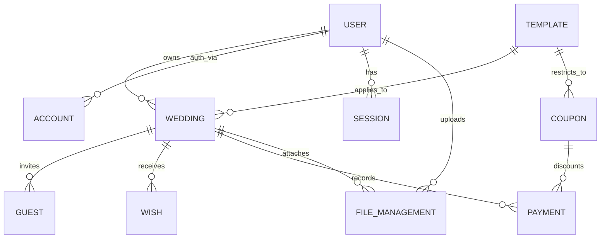

# Đặc Tả 02: Lược Đồ Cơ Sở Dữ Liệu (Database Specification)

Hệ thống sử dụng cơ sở dữ liệu **PostgreSQL** kết hợp với **Prisma ORM**. Tài liệu này mô tả chi tiết toàn bộ thực thể, kiểu dữ liệu, ràng buộc quan hệ và chiến lược đánh chỉ mục (Index).

---

## 1. Sơ Đồ Quan Hệ Thực Thể (ERD Overview)



---

## 2. Chi Tiết Các Thực Thể (Models)

### 2.1. Model `User` (Tài khoản người dùng)
Quản lý thông tin tài khoản cô dâu, chú rể và ban quản trị (Admin).

| Trường | Kiểu Dữ Liệu | Ràng Buộc | Mô Tả |
| :--- | :--- | :--- | :--- |
| `id` | String | PK, cuid() | Định danh duy nhất người dùng |
| `name` | String? | Nullable | Tên hiển thị |
| `email` | String? | Unique, Nullable | Địa chỉ email đăng nhập |
| `emailVerified` | DateTime? | Nullable | Thời điểm xác thực email |
| `image` | String? | Nullable | Avatar người dùng |
| `phone` | String? | Nullable | Số điện thoại liên hệ |
| `password` | String? | Nullable | Mật khẩu hash Bcrypt |
| `role` | Role | Default `USER` | Quyền hạn: `USER` hoặc `ADMIN` |
| `createdAt` / `updatedAt` | DateTime | Timestamp | Thời điểm tạo và sửa |

### 2.2. Model `Wedding` (Thiệp cưới)
Thực thể trung tâm lưu giữ toàn bộ dữ liệu tổ chức đám cưới của cặp đôi.

| Trường | Kiểu Dữ Liệu | Ràng Buộc | Mô Tả |
| :--- | :--- | :--- | :--- |
| `id` | String | PK, cuid() | Mã định danh duy nhất của thiệp |
| `slug` | String | Unique, Index | Đường dẫn URL thiệp (vd: `thanhtung-huonggiang`) |
| `userId` | String | FK -> User, Index | Chủ sở hữu thiệp |
| `templateId` | String | FK -> Template | Mẫu thiệp được áp dụng |
| `status` | WeddingStatus | Default `DRAFT` | Trạng thái: `DRAFT`, `DEMO`, `PUBLISHED`, `EXPIRED` |
| `paidAt` | DateTime? | Nullable | Thời điểm thanh toán xuất bản |
| `expiresAt` | DateTime? | Nullable | Thời hạn hiển thị công khai (+30 ngày) |
| `purchasePrice` | Int? | Nullable | Số tiền đã thanh toán (VND) |
| `groomName` | String | Not Null | Tên chú rể |
| `brideName` | String | Not Null | Tên cô dâu |
| `groomParents` | Json | Not Null | `{ father: string, mother: string }` |
| `brideParents` | Json | Not Null | `{ father: string, mother: string }` |
| `groomCeremony`| Json | Not Null | Chi tiết lễ Tân Hôn (ngày dương, âm, giờ, địa điểm, map) |
| `brideCeremony`| Json | Not Null | Chi tiết lễ Vu Quy (ngày dương, âm, giờ, địa điểm, map) |
| `quote` | String? | Nullable | Câu danh ngôn / Lời nhắn gửi |
| `gallery` | Json | Array string | Mảng URL danh sách ảnh cưới |
| `gifting` | Json? | Nullable | Thông tin tài khoản mừng cưới (groom & bride) |
| `primaryColor` | String? | `#800020` | Mã màu chủ đạo HEX |
| `accentColor` | String? | `#d4a853` | Mã màu điểm nhấn HEX |
| `backgroundColor` | String? | Nullable | Màu nền thiệp |
| `textColor` | String? | `#4A4A4A` | Màu chữ chính |
| `typography` | Json? | Nullable | Cấu hình font chữ (`heading`, `body`, `script`) |
| `sectionOrder` | Json? | Array string | Mảng thứ tự các khối hiển thị |
| `backgroundMusic`| String? | Nullable | URL bài hát nhạc nền |
| `metaTitle` / `metaDescription` / `ogImage` | String? | Nullable | Tùy chỉnh thẻ SEO và OpenGraph khi chia sẻ Facebook/Zalo |
| `viewCount` | Int | Default `0` | Tổng lượt truy cập thiệp |

### 2.3. Model `Template` (Mẫu thiệp cưới)
Quản lý danh mục mẫu thiệp, giá bán và cấu hình khối.

| Trường | Kiểu Dữ Liệu | Ràng Buộc | Mô Tả |
| :--- | :--- | :--- | :--- |
| `id` | String | PK, cuid() | Mã định danh template |
| `name` | String | Not Null | Tên mẫu thiệp (vd: "Classic Elegance") |
| `slug` | String | Unique | Slug template (vd: `classic-elegance`) |
| `description` | String | Not Null | Mô tả ngắn phong cách |
| `thumbnail` | String | Not Null | Ảnh đại diện preview mẫu thiệp |
| `category` | String | Not Null | Phân loại: `classic`, `modern`, `vintage`, `minimal` |
| `price` | Int | Not Null | Giá xuất bản gốc (VND) |
| `salePrice` | Int? | Nullable | Giá khuyến mãi (VND) |
| `saleStartsAt` / `saleEndsAt` | DateTime? | Nullable | Khoảng thời gian áp dụng giảm giá |
| `config` | Json | Not Null | Cấu hình mặc định (defaultColors, sections) |

### 2.4. Model `Guest` (Danh sách khách mời)
Cá nhân hóa thiệp mời cho từng khách mời riêng biệt.

| Trường | Kiểu Dữ Liệu | Ràng Buộc | Mô Tả |
| :--- | :--- | :--- | :--- |
| `id` | String | PK, cuid() | Mã khách mời |
| `weddingId` | String | FK -> Wedding, Cascade | Thuộc thiệp cưới nào |
| `name` | String | Not Null | Tên khách mời (vd: "Hoàng Long") |
| `salutation` | String? | Nullable | Cách xưng hô (vd: "Anh", "Bạn", "Cô", "Chú") |
| `phone` / `email` | String? | Nullable | Liên hệ khách mời |
| `side` | Side | Default `GROOM` | Thuộc bên: `GROOM` (Nhà trai) hoặc `BRIDE` (Nhà gái) |
| `group` | String? | Nullable | Nhóm khách: "Bạn cấp 3", "Đồng nghiệp", "Họ hàng" |
| `rsvpStatus` | RSVPStatus | Default `PENDING` | `PENDING`, `ACCEPTED`, `DECLINED` |
| `numberOfGuests`| Int | Default `1` | Số lượng người đi cùng |
| `inviteLink` | String? | Unique, Nullable | Link mời riêng biệt kèm mã bảo mật |
| `linkOpened` | Boolean | Default `false` | Khách đã bấm vào xem thiệp chưa |

### 2.5. Model `Wish` (Lời chúc mừng)
| Trường | Kiểu Dữ Liệu | Ràng Buộc | Mô Tả |
| :--- | :--- | :--- | :--- |
| `id` | String | PK, cuid() | Mã lời chúc |
| `weddingId` | String | FK -> Wedding, Cascade | Thuộc thiệp cưới nào |
| `name` | String | Not Null | Tên người chúc |
| `message` | String | Not Null | Nội dung lời chúc |
| `attendance` | String? | Nullable | "Tham dự" hoặc "Rất tiếc không thể" |
| `isApproved` | Boolean | Default `true` | Trạng thái duyệt hiển thị |

### 2.6. Model `Payment` (Giao dịch thanh toán)
| Trường | Kiểu Dữ Liệu | Ràng Buộc | Mô Tả |
| :--- | :--- | :--- | :--- |
| `id` | String | PK, cuid() | Mã thanh toán |
| `weddingId` | String | FK -> Wedding | Thiệp cưới cần thanh toán |
| `type` | PaymentType | Default `PUBLISH` | `PUBLISH`, `RENEW`, `TEMPLATE_CHANGE` |
| `amount` | Int | Not Null | Số tiền thực thu (VND) |
| `basePrice` | Int? | Nullable | Giá gốc tại thời điểm thanh toán |
| `couponId` | String? | FK -> Coupon | Mã giảm giá đã áp dụng |
| `couponDiscount`| Int? | Nullable | Số tiền đã giảm trừ |
| `method` | String | Not Null | `bank_transfer` (Casso / VietQR) |
| `status` | PaymentStatus | Default `PENDING`| `PENDING`, `COMPLETED`, `FAILED`, `REFUNDED` |
| `paidAt` | DateTime? | Nullable | Thời điểm tiền vào tài khoản |

### 2.7. Model `Coupon` (Mã giảm giá)
| Trường | Kiểu Dữ Liệu | Ràng Buộc | Mô Tả |
| :--- | :--- | :--- | :--- |
| `id` | String | PK, cuid() | Mã coupon |
| `code` | String | Unique | Mã nhập (vd: `HAPPYWEDDING2026`) |
| `discountType` | CouponDiscountType | Not Null | `FIXED` (VND) hoặc `PERCENT` (%) |
| `discountValue`| Int | Not Null | Giá trị giảm |
| `templateId` | String? | FK -> Template | Giới hạn template áp dụng (null = toàn bộ) |
| `maxRedemptions`| Int? | Nullable | Lượt dùng tối đa (null = không giới hạn) |
| `redemptionCount`| Int | Default `0` | Số lượt đã sử dụng |
| `isActive` | Boolean | Default `true` | Trạng thái kích hoạt |

---

## 3. Danh Mục Enums Hệ Thống

```prisma
enum Role {
  USER
  ADMIN
}

enum WeddingStatus {
  DRAFT       // Thiệp mới tạo, chưa thanh toán (chỉ chủ thiệp xem được)
  DEMO        // Thiệp chia sẻ dùng thử (kèm watermark)
  PUBLISHED   // Đã thanh toán, hoạt động công khai
  EXPIRED     // Đã quá hạn sử dụng 30 ngày kể từ ngày publish
}

enum PaymentType {
  PUBLISH         // Xuất bản thiệp lần đầu
  RENEW           // Gia hạn thêm 30 ngày
  TEMPLATE_CHANGE // Nâng cấp sang mẫu thiệp khác
}

enum PaymentStatus {
  PENDING
  COMPLETED
  FAILED
  REFUNDED
}

enum Side {
  GROOM
  BRIDE
}

enum RSVPStatus {
  PENDING
  ACCEPTED
  DECLINED
}

enum CouponDiscountType {
  FIXED
  PERCENT
}
```
