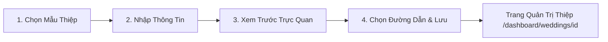

# Đặc Tả 04: Luồng Tạo Thiệp & Trình Soạn Thảo (Creation & Editor Specification)

Quy trình trải nghiệm từ lúc người dùng bắt đầu chọn mẫu thiệp đến khi hoàn thiện tùy biến được thiết kế trực quan, giảm thiểu thao tác gõ phím và phản hồi tức thì bằng hình ảnh thực tế.

---

## 1. Luồng Khởi Tạo Thiệp (New Wedding Wizard)

Trang `/dashboard/weddings/new` sử dụng wizard 4 bước tuần tự:



### Bước 1: Chọn Mẫu Thiệp (Template Selection)
- Hiển thị danh sách thẻ mẫu thiệp với ảnh thumbnail sắc nét, phân loại category (Cổ điển, Hiện đại, Màu nước...) và giá xuất bản niêm yết rõ ràng.
- Hỗ trợ xem nhanh demo qua nút "Xem thử mẫu" mở popup tương tác.
- Tự động nhận diện query param `?template={slug}` để chọn trước mẫu khi người dùng chuyển từ trang `/templates` sang.

### Bước 2: Nhập Thông Tin Đám Cưới (Wedding Details)
- Thông tin cặp đôi: Tên chú rể, tên cô dâu, thông tin thân phụ/thân mẫu hai bên.
- Thông tin hai lễ:
  - Lễ Tân Hôn (Nhà trai): Ngày dương lịch, ngày âm lịch, giờ làm lễ, giờ nhập tiệc, tên địa điểm, địa chỉ và link Google Maps.
  - Lễ Vu Quy (Nhà gái): Đầy đủ các trường tương tự nhà trai.
- Lời chúc / Thông điệp mặc định.
- **Nút "Sample Data" (Thanh Tùng & Hương Giang)**: Cho phép 1-click điền toàn bộ dữ liệu mẫu đầy đủ để trải nghiệm hoặc test nhanh tính năng.

### Bước 3: Xem Trước Trực Quan (Interactive Preview)
- Render trực tiếp mẫu thiệp thực tế thông qua component `TemplateRenderer` kết hợp với thông tin người dùng vừa nhập ở Bước 2.
- Người dùng có thể kiểm tra trực quan giao diện, căn chỉnh font chữ, kiểm tra địa điểm và cảm nhận thiệp của mình trước khi lưu.

### Bước 4: Cấu Hình URL Slug & Hoàn Tất (Slug Configuration)
- Tự động gợi ý slug chuẩn SEO không dấu từ tên cặp đôi (vd: `thanhtung-huonggiang`).
- Kiểm tra tính duy nhất của slug trên toàn hệ thống.
- Nhấn "Tạo Thiệp Cưới" -> Gọi `POST /api/weddings`, lưu bản ghi trạng thái `DRAFT` và điều hướng ngay về trang quản trị `/dashboard/weddings/[id]`.

---

## 2. Kiến Trúc Bộ Tùy Biến Trực Quan (Live Customizer)

Nằm tại đường dẫn `/dashboard/weddings/[id]/edit`. Giao diện chia 2 cột kinh điển (Split View):

```
+------------------------------------+------------------------------------+
|  FORM CẤU HÌNH (BÊN TRÁI)          |  LIVE PREVIEW IFRAME (BÊN PHẢI)    |
|                                    |  URL: /w/preview                   |
|  [Tab: Thông tin chung]            |  +------------------------------+  |
|  [Tab: Hình ảnh & Album]           |  |                              |  |
|  [Tab: Giao diện & Màu sắc]        |  |   Hiển thị thiệp cưới thật   |  |
|  [Tab: Bật/Tắt các Khối]           |  |   với hiệu ứng mở phong bì   |  |
|  [Tab: Nhạc nền & Lời mời]         |  |   và nhạc nền đang chạy.     |  |
|                                    |  |                              |  |
|  Nút "Lưu thay đổi"                |  +------------------------------+  |
+------------------------------------+------------------------------------+
```

---

## 3. Cơ Chế Giao Tiếp Thời Gian Thực (Iframe PostMessage Protocol)

Trang cha (`/dashboard/weddings/[id]/edit`) và trang con Iframe (`/w/preview`) đồng bộ dữ liệu hai chiều không độ trễ thông qua giao thức HTML5 `window.postMessage`:

### 3.1. Từ Trang Cha -> Gửi Vào Iframe
- `type: "UPDATE_DRAFT"`:
  ```json
  {
    "type": "UPDATE_DRAFT",
    "templateSlug": "classic-elegance",
    "wedding": { ...weddingData },
    "mode": "groom",
    "highlightSlot": "wedding-info"
  }
  ```
  Mỗi khi người dùng gõ vào form hoặc đổi màu/đổi ảnh, trang cha phát sự kiện này để Iframe re-render ngay tức thì mà không cần tải lại trang.

### 3.2. Từ Iframe -> Gửi Ngược Ra Trang Cha
- `type: "PREVIEW_READY"`: Iframe thông báo đã mount xong, sẵn sàng nhận dữ liệu ban đầu.
- `type: "SLOT_CLICK"`: Người dùng click vào một khối trên thiệp trong iframe -> Báo cho trang cha tự động nhảy đến đúng tab và focus vào ô nhập liệu tương ứng.
- `type: "FIELD_CHANGE"`: Cập nhật nhanh một trường text từ popover nổi trên thiệp.
- `type: "GALLERY_CHANGE"`: Cập nhật danh sách ảnh cưới sau khi đổi ảnh trực tiếp.

---

## 4. Trình Soạn Thảo Nổi Tại Chỗ (SlotEditPopover)

Khi rê chuột vào các phần tử trên bản preview trong editor, các vùng nhập liệu (Slot Key) sẽ hiển thị viền highlight mỏng. Nhấp chuột vào phần tử sẽ mở một Popover nhỏ ngay tại vị trí click (`SlotEditPopover`), cho phép:
- Thay đổi nhanh tên cô dâu, chú rể.
- Thay đổi ảnh đại diện hoặc tải ảnh mới lên trực tiếp.
- Giúp người dùng chỉnh sửa nhanh mà không cần mất công tìm kiếm vị trí trường trong form dài bên trái.
