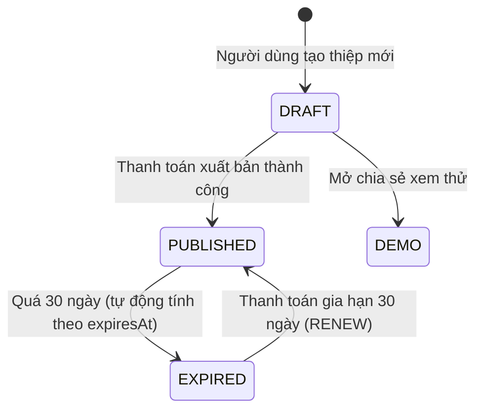

# Đặc Tả 05: Trang Thiệp Công Khai & Tương Tác Khách Mời (Public Invitation View & Guest Flow)

Trang thiệp công khai phục vụ tại đường dẫn `/w/[slug]` là sản phẩm cuối cùng gửi đến quan khách và bạn bè. Trang được tối ưu hóa cho hiển thị trên điện thoại di động (Mobile-first), tốc độ tải trang cao và các hiệu ứng mở đầu trang trọng.

---

## 1. Phân Quyền Truy Cập & Vòng Đời Trạng Thái (Lifecycle)

Trang Server Component [app/w/[slug]/page.tsx](file:///e:/Project/online%20wedding%20invitations/online-wedding-invitations/app/w/%5Bslug%5D/page.tsx) kiểm soát quyền hiển thị theo trạng thái hiệu lực thực tế (`getEffectiveWeddingStatus`):

| Trạng Thái | Điều Kiện Truy Cập | Giao Diện Hiển Thị |
| :--- | :--- | :--- |
| **DRAFT** | Chỉ chủ sở hữu (UserId khớp Session đăng nhập) | Xem toàn bộ thiệp. Người lạ truy cập sẽ nhận thông báo: *"Thiệp cưới chưa được phát hành"*. |
| **DEMO** | Công khai toàn bộ người dùng | Hiển thị thiệp kèm huy hiệu Watermark dùng thử ở chân trang. |
| **PUBLISHED** | Công khai toàn bộ người dùng | Hiển thị thiệp bản quyền chính thức, không watermark, thời hạn 30 ngày. |
| **EXPIRED** | Công khai toàn bộ người dùng | Màn hình thông báo: *"Thiệp cưới đã hết hạn. Vui lòng liên hệ cô dâu chú rể để biết thêm chi tiết"*. |

---

## 2. Các Tham Số URL Động (Dynamic Query Parameters)

### 2.1. Chuyển Đổi Chế Độ Nhà Trai / Nhà Gái (`?mode=`)
- `?mode=groom` hoặc `?mode=nhatrai` (Mặc định):
  - Tiêu đề lễ: **Lễ Tân Hôn**.
  - Hiển thị ngày giờ, địa chỉ tiệc cưới và thông tin gia đình nhà trai lên trước.
  - Mã QR mừng cưới mặc định ưu tiên tài khoản chú rể.
- `?mode=bride` hoặc `?mode=nhagai`:
  - Tiêu đề lễ: **Lễ Vu Quy**.
  - Hiển thị ngày giờ, địa chỉ tiệc cưới và thông tin gia đình nhà gái lên trước.
  - Mã QR mừng cưới mặc định ưu tiên tài khoản cô dâu.

### 2.2. Cá Nhân Hóa Khách Mời (`?guest=` & `?salutation=`)
- Ví dụ: `/w/thanhtung-huonggiang?guest=Hoang%20Long&salutation=Anh`
- Khi mở thiệp:
  - Trên nắp phong bì hiển thị: *"Trân trọng kính mời: Anh Hoàng Long"*.
  - Trong nội dung lời mời tự động điền danh xưng thân mật.
  - Form RSVP và gửi lời chúc tự động điền sẵn tên khách mời, người dùng không cần gõ lại.

---

## 3. Các Khối Chức Năng Tương Tác Cốt Lõi

### 3.1. Hoạt Cảnh Mở Phong Bì (Envelope Card Opening)
- Lớp bìa thư mô phỏng phong bì thiệp cao cấp.
- Con dấu sáp (Wax Seal) dập nổi chữ lồng hoặc họa tiết hỷ sự.
- Khách bấm vào con dấu sáp -> Nắp phong bì mở ra với hoạt cảnh 3D mượt mà, lá thư cưới trượt nhẹ lên và nhạc nền bắt đầu phát.

### 3.2. Trình Phát Nhạc Nền (Background Music Player)
- Hỗ trợ file MP3/AAC chất lượng cao qua URL.
- Nút điều khiển xoay tròn hình đĩa than hoặc nốt nhạc ở góc màn hình, cho phép khách bật/tắt âm thanh bất cứ lúc nào.
- Xử lý mượt mà chính sách chặn Autoplay của trình duyệt di động: kích hoạt nhạc ngay sau cử chỉ chạm mở phong bì của khách.

### 3.3. Đồng Hồ Đếm Ngược (Wedding Countdown)
- Tính toán thời gian thực theo múi giờ Việt Nam (GMT+7).
- Đếm từng ngày, giờ, phút, giây đến thời khắc làm lễ trọng đại.

### 3.4. Bản Đồ Chỉ Đường (Location & Navigation)
- Hiển thị bản đồ Google Maps nhúng.
- Nút "Chỉ đường trên Google Maps" mở ứng dụng bản đồ trên điện thoại để dẫn đường tức thì.

### 3.5. Xác Nhận Tham Dự (RSVP)
- Cho phép khách phản hồi:
  - Sẽ tham dự hay Tiếc nuối không thể tham dự.
  - Số lượng người tham dự đi cùng.
  - Khách bên Nhà Trai hay Nhà Gái.
- Dữ liệu gửi về `POST /api/rsvp` và cập nhật tức thì vào trang quản lý Dashboard của cô dâu chú rể.

### 3.6. Sổ Lưu Bút & Lời Chúc (Wishes Guestbook)
- Khách để lại lời chúc mừng trăm năm hạnh phúc.
- Danh sách lời chúc được hiển thị cuộn hoặc slider băng chuyền đẹp mắt.

### 3.7. Hộp Mừng Cưới Thông Minh (Smart Gifting VietQR)
- Hiển thị số tài khoản ngân hàng của chú rể và cô dâu.
- Tích hợp ảnh VietQR chuẩn Napas 247 được tạo tự động: khách chỉ cần quét mã bằng app ngân hàng là thông tin số tài khoản, tên ngân hàng và nội dung *"Mừng cưới <Tên Khách>"* được điền sẵn 100%.

---

## 4. Tối Ưu Hóa Tìm Kiếm (SEO & Social Sharing)

Trang `/w/[slug]` tự động sinh thẻ OpenGraph và dữ liệu có cấu trúc chuẩn Schema.org:

- **OpenGraph / Zalo / Facebook**:
  - `og:title`: `Thiệp Cưới ${groomName} & ${brideName}`.
  - `og:description`: `Trân trọng kính mời bạn đến chung vui cùng ${groomName} & ${brideName}`.
  - `og:image`: Ảnh đại diện thiệp do người dùng cấu hình hoặc ảnh bìa đám cưới.
- **JSON-LD Schema (`Event`)**: Khai báo ngày giờ, tên sự kiện, địa điểm tổ chức để các công cụ tìm kiếm hiểu và hiển thị Rich Snippet sự kiện đám cưới.
