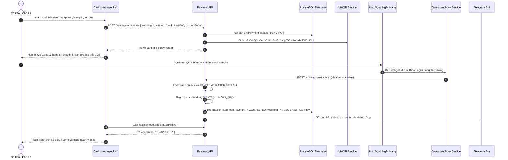

# Đặc Tả 06: Hệ Thống Thanh Toán & Tích Hợp Casso / VietQR (Payment & Casso Specification)

Hệ thống cung cấp giải pháp thanh toán tự động qua hình thức chuyển khoản ngân hàng Việt Nam (VietQR 247). Việc xác nhận giao dịch và kích hoạt thiệp cưới được thực hiện hoàn toàn tự động thông qua **Casso Webhook** (hoặc cổng ngân hàng tương đương).

---

## 1. Mô Hình Định Giá & Báo Giá (Quote Model)

Mỗi mẫu thiệp có giá xuất bản niêm yết riêng biệt trong cơ sở dữ liệu:
- **Giá gốc (`price`)**: VND (ví dụ: 500,000đ cho Classic, 1,000,000đ cho Modern Cinematic).
- **Giá khuyến mãi (`salePrice`)**: Có hiệu lực trong khoảng `[saleStartsAt, saleEndsAt]`.
- **Mã giảm giá (`Coupon`)**: Có thể giảm số tiền cố định (`FIXED`) hoặc theo tỷ lệ phần trăm (`PERCENT`).
- **Thời hạn bản quyền thiệp**: Mỗi lần xuất bản hoặc gia hạn có hiệu lực **30 ngày**. Nếu thiệp đang còn hạn mà gia hạn tiếp, thời hạn mới sẽ được cộng dồn tiếp nối thời hạn cũ.

---

## 2. Quy Trình Thanh Toán Tự Động (End-to-End Flow)



---

## 3. Quy Chuẩn Cú Pháp Chuyển Khoản (Transfer Syntax)

Nội dung chuyển khoản được chuẩn hóa nghiêm ngặt bởi hàm `generateTransferContent`:

$$\text{Cú pháp: } \mathbf{TC\langle 8 \text{ ký tự cuối của WeddingId}\rangle \text{ } \langle TYPE\rangle}$$

- **Ví dụ**: Thiệp có ID `cm5k8w9ab000108l412345678` -> 8 ký tự cuối là `12345678`.
- **Nội dung hiển thị trên VietQR**: `TC12345678 PUBLISH`
- **Lợi ích**:
  - Đủ ngắn gọn để không bị ngân hàng cắt bớt ký tự (SMS/Mobile Banking thường giới hạn 20-30 ký tự).
  - Định danh chính xác 100% thiệp cưới và mục đích thanh toán (`PUBLISH`, `RENEW`, `TEMPLATE_CHANGE`).

---

## 4. Xử Lý Webhook Casso Bảo Mật & Đảm Bảo Tính Toàn Vẹn

Mã nguồn tại [app/api/webhooks/casso/route.ts](file:///e:/Project/online%20wedding%20invitations/online-wedding-invitations/app/api/webhooks/casso/route.ts):

1. **Xác thực bảo mật**:
   ```typescript
   if (request.headers.get("x-api-key") !== process.env.CASSO_WEBHOOK_SECRET) {
     return NextResponse.json({ error: "Unauthorized" }, { status: 401 });
   }
   ```
2. **So khớp giao dịch**:
   - Quét qua mảng giao dịch `transactions` do Casso gửi tới.
   - Tìm kiếm `TC([a-zA-Z0-9_-]{8})`.
   - Tìm ứng viên Payment trạng thái `PENDING` có `weddingId` kết thúc bằng 8 ký tự trên.
   - Kiểm tra số tiền chuyển `paidAmount >= payment.amount`.
3. **Idempotency (Không bị lặp giao dịch)**:
   - Sử dụng hàm `completePaymentIfPending(prisma, payment.id, ...)` chạy trong Prisma Transaction `$transaction`.
   - Nếu payment đã chuyển sang `COMPLETED` từ trước, hàm lập tức bỏ qua, không kích hoạt lặp lại.
4. **Kích hoạt gói & Gia hạn**:
   - `Wedding.status` chuyển thành `PUBLISHED`.
   - `Wedding.paidAt` lưu thời điểm thanh toán.
   - `Wedding.expiresAt` được tính: `max(expiresAt hiện tại, now) + 30 ngày`.
   - Ghi nhận `purchasePrice = payment.amount`.

---

## 5. Hướng Dẫn Tích Hợp Tài Khoản Ngân Hàng & Casso Khi Bàn Giao

Khi người dùng cung cấp tài khoản Casso, chỉ cần thực hiện 2 bước đơn giản:

### Bước 1: Cấu hình biến môi trường trong file `.env`
```env
# ==========================================
# CẤU HÌNH NGÂN HÀNG & CASSO (VIETQR 247)
# ==========================================
# Thông tin tài khoản thụ hưởng hiển thị cho khách
BANK_NAME="MBBank"                 # Tên viết tắt ngân hàng (VCB, MBBank, Techcombank, ACB, VPBank...)
BANK_ACCOUNT_NUMBER="0987654321"    # Số tài khoản ngân hàng của bạn
BANK_ACCOUNT_HOLDER="NGUYEN VAN A" # Tên chủ tài khoản (viết hoa không dấu)

# Khóa bí mật kết nối với Casso
CASSO_API_KEY="casso_api_key_cua_ban"
CASSO_WEBHOOK_SECRET="mot_chuoi_bi_mat_ngau_nhien_do_ban_dat" # Ví dụ: "wedding_sec_99882244"
```

### Bước 2: Đăng ký Webhook trên Bảng Điều Khiển Casso
1. Đăng nhập vào trang quản trị Casso (casso.vn).
2. Kết nối tài khoản ngân hàng của bạn.
3. Vào mục **Thiết lập Webhook** -> Tạo webhook mới:
   - **URL Webhook**: `https://<ten-mien-cua-ban>/api/webhooks/casso`
   - **Header bổ sung**: Thêm header `x-api-key` với giá trị chính là chuỗi `CASSO_WEBHOOK_SECRET` đã đặt trong `.env`.
   - **Sự kiện**: Chọn nhận thông báo biến động số dư.
4. Nhấn **Lưu & Kiểm tra kết nối**. Toàn bộ quy trình thanh toán sẽ tự động vận hành trơn tru!
