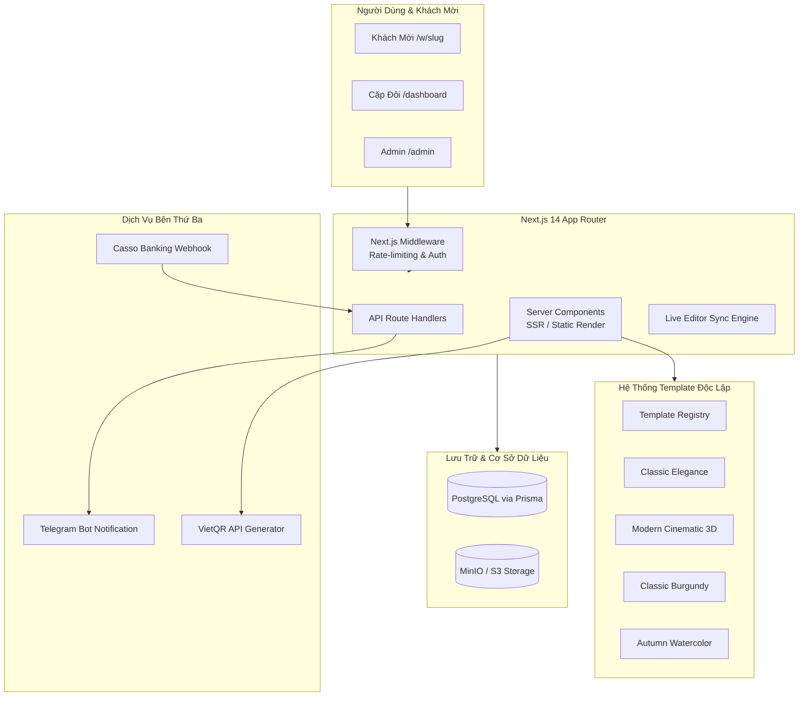

# Tài Liệu Đặc Tả Kỹ Thuật Hệ Thống Thiệp Cưới Online (Specs)

Tài liệu này là trung tâm đặc tả kỹ thuật (Single Source of Truth) của toàn bộ dự án **Online Wedding Invitations (Thiệp Cưới Online)**. Tất cả các quyết định kiến trúc, lược đồ cơ sở dữ liệu, quy chuẩn template, cơ chế soạn thảo và tích hợp thanh toán đều được chuẩn hóa và quản lý tập trung tại đây.

---

## Danh Mục Các Module Đặc Tả

| Mã Module | Tài Liệu Đặc Tả | Phạm Vi & Chức Năng |
| :--- | :--- | :--- |
| **Graph** | [CODE_GRAPH.md](../CODE_GRAPH.md) | **Sơ đồ Code Graph & Kiến trúc hệ thống**: Trực quan hóa toàn diện bằng Mermaid: Layered Architecture, ERD, Template Engine, Data Flows. |
| **01** | [01-system-overview.md](01-system-overview.md) | Tổng quan kiến trúc hệ thống, Tech stack (Next.js 14 App Router, PostgreSQL, Tailwind), triết lý Clean Architecture, bảo mật & luồng dữ liệu. |
| **02** | [02-database-spec.md](02-database-spec.md) | Chi tiết lược đồ cơ sở dữ liệu (Prisma Schema), các bảng thực thể (User, Wedding, Template, Guest, Wish, Payment, Coupon), quan hệ và chiến lược Index. |
| **03** | [03-templates-spec.md](03-templates-spec.md) | Hệ thống Template Engine: Template Registry, cấu trúc ImageSlots & TextSlots, Dynamic Fonts/Colors, đặc tả chi tiết 4 template hiện hữu và hướng dẫn mở rộng. |
| **04** | [04-creation-and-editor-spec.md](04-creation-and-editor-spec.md) | Luồng tạo thiệp (Wizard 4 bước), kiến trúc Bộ soạn thảo trực quan (Live Customizer), cơ chế đồng bộ Form-Preview qua `window.postMessage`, Inline Popover. |
| **05** | [05-invitation-public-view-spec.md](05-invitation-public-view-spec.md) | Trang thiệp công khai `/w/[slug]`: Chế độ Nhà Trai / Nhà Gái, cá nhân hóa khách mời, hiệu ứng mở phong bì, nhạc nền, Countdown, RSVP, Lời chúc, Mừng cưới QR. |
| **06** | [06-payment-and-casso-spec.md](06-payment-and-casso-spec.md) | Hệ thống thanh toán tự động qua Casso (VietQR): Quy chuẩn cú pháp `TC<shortId>`, Webhook bảo mật `x-api-key`, Idempotency, Kích hoạt & Gia hạn thiệp, Hướng dẫn tích hợp tài khoản Casso. |
| **07** | [07-api-reference.md](07-api-reference.md) | Danh mục chuẩn toàn bộ REST API Endpoints: Auth, Weddings, Templates, Guests, RSVP, Wishes, Payment, Webhooks, Upload. |
| **08** | [08-admin-and-operations.md](08-admin-and-operations.md) | Phân quyền ADMIN vs USER, Dashboard quản trị, Thống kê doanh thu, Quản lý Template & Mã giảm giá (Coupons), Quy trình sao lưu & Vận hành. |

---

## Kiến Trúc Tổng Thể Hệ Thống

---

## Tiêu Chuẩn & Hướng Dẫn Phát Triển

1. **Tuân thủ TypeScript nghiêm ngặt**: Không sử dụng `any`, định kiểu đầy đủ cho mọi dữ liệu truyền giữa các tầng.
2. **Nguyên tắc Clean Architecture**: Tách biệt rõ ràng Data Access (`@/lib/prisma`), Business Logic (`@/lib/*`), Presentation (`@/components/*`) và Routing (`@/app/*`).
3. **Phát triển Template**: Mọi template mới phải đăng ký đồng thời tại `lib/template-registry.ts` và `prisma/template-defs.cjs`, hỗ trợ đầy đủ các Section cơ bản và responsive 100% mobile-first.
